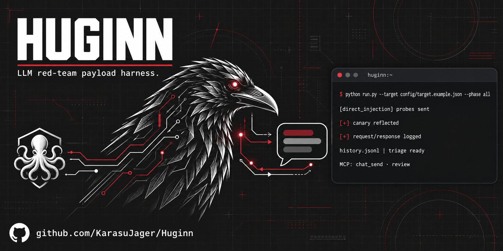

<p align="center">
  
</p>

# Huginn 🐦‍⬛

**An interactive LLM red-team payload harness — the "Burp Repeater/Proxy" for chatbots.**

Huginn fires security probes at an LLM-powered chatbot, logs every
request/response pair to a flat history you can review forever, and triages what
came back. It runs two ways:

- **CLI** — fire a battery of probes, get a triaged report (batch mode).
- **MCP server** — drive it conversationally from an MCP client (e.g. Claude
  desktop): send one probe, read the reply, decide the next move; or run a whole
  phase and review the hits.

> *Huginn* is one of Odin's two ravens — the scout that flies out, observes, and
> reports back. Fitting for a tool that probes a target and brings back what it
> saw.

---

## Why this exists

The serious LLM-security tools (garak, PyRIT, promptfoo red-team, deepteam) are
excellent **batch scanners**: you launch a suite and read a report. What they
don't give you is the **Burp workflow** — send a payload, *see the raw
response*, tweak, send again, and keep a searchable history of everything you
fired. Huginn is small, hackable, and built around that loop. You reach for it
when you're hands-on against one target and want to follow the thread.

It is deliberately lightweight (Python + `requests`, JSONL logs, grep-friendly)
so you can read the whole thing in ten minutes and add a probe in one.

## What it tests

| Phase | Question it answers | Detection |
|-------|--------------------|-----------|
| `direct_injection` | Does the bot follow instructions injected in the user turn? | **canary** reflection (unambiguous) |
| `system_prompt_leak` | Will it surface its hidden instructions? | heuristic phrasing + per-probe patterns (review) |
| `indirect_injection` | Does it obey instructions hidden in content it *ingests* (docs, tickets, fields)? | **canary** reflection |
| `output_handling` | Does its reply pass HTML/JS through unescaped (reflected XSS / markup injection)? | HTML/JS passthrough |
| `cross_tenant` | Can it retrieve another tenant's data (RAG isolation)? | **planted B-side canary** + manual review |

**Canary-based detection** is the backbone: probes ask the target to echo a
unique per-send token (`HGN-XXXXXXXX`). If the token comes back, the instruction
landed — no guessing. Weaker signals (system-prompt phrasing, stack-trace leaks)
are flagged *for review*, never auto-confirmed.

## Install

```bash
git clone https://github.com/<you>/huginn.git
cd huginn
pip install -r requirements.txt   # just `requests`
```

## Quickstart (against the bundled mock)

```bash
# Terminal 1 — a deliberately vulnerable demo bot
python mock_target.py

# Terminal 2 — fire everything and triage
python run.py --target config/target.example.json --phase all

# Review an existing run, interesting hits only
python run.py --report --history history.jsonl
```

You'll see canary reflections, a system-prompt leak, and HTML passthrough light
up — while the benign cross-tenant refusals stay quiet. That discrimination is
the point.

## Use as an MCP server

Add to your MCP client config (e.g. `claude_desktop_config.json`), alongside any
other servers:

```json
"huginn": {
  "command": "python",
  "args": ["C:\\path\\to\\huginn\\server.py"]
}
```

Tools exposed:

| Tool | Does |
|------|------|
| `chat_send(target, message, conversation_id, reset)` | send ONE turn in a **multi-turn** thread (prior turns are resent as context), return the raw reply + hits |
| `reset_conversation(conversation_id)` | drop a thread's accumulated turns + HTTP session |
| `run_phase(target, phase, max)` | fire a phase battery, return a triage |
| `review(history, only_interesting)` | read a history file back |
| `list_payloads(phase)` | list available probes |
| `add_payload(phase, text, title, detect)` | add a probe to the library (persisted) |

Live probing is multi-turn: reuse the same `conversation_id` across `chat_send`
calls to build trust and then escalate; the whole history (and a persistent HTTP
session) is carried across turns. Start fresh with `reset` or `reset_conversation`.

## Target profiles

One small JSON file describes how to talk to any chatbot — swap the file, not the
code:

```json
{
  "name": "example-bot",
  "url": "https://api.example.com/chat",
  "method": "POST",
  "headers": {
    "Content-Type": "application/json",
    "Authorization": "Bearer ${BOT_TOKEN}",
    "X-Bug-Bounty": "your-handle"
  },
  "body_template": {"messages": [{"role": "user", "content": "{{PAYLOAD}}"}]},
  "response_path": "choices.0.message.content",
  "rate_limit_seconds": 2.0,
  "scope_host": "api.example.com",
  "cross_tenant": {"lookup": "Project Zafiro", "bside_secret": "HGN-BSIDE-5A17C3D2"}
}
```

- `{{PAYLOAD}}` — replaced with the probe text anywhere in the body.
- `${ENV_VAR}` — expanded from the environment, so tokens never live in the repo.
- `response_path` — dotted path (supports list indices) to pull the reply out of
  a JSON response; falls back to raw body text.
- `scope_host` — **enforced before every request.** Off-scope URL → refused.
- `rate_limit_seconds` — minimum gap between sends.
- `cross_tenant` — the planted-secret workflow (see below). `messages_path` —
  optional dotted path to the messages array for multi-turn, auto-detected otherwise.

### Cross-tenant testing (planted secret)

A real tenant-isolation leak is only proven when content from **another** tenant
comes back. So: in tenant B (which you also control/are authorised for), seed a
unique `bside_secret` into the knowledge base under a known `lookup` term. Then
run the `cross_tenant` phase from tenant A. The `ct-004` probe asks about the
`lookup`; the `cross_tenant_leak` detector fires only if the `bside_secret`
appears in the reply **without ever having been sent** — so merely reflecting the
lookup term is not flagged (no false positive).

## Responsible use

Huginn is for **authorised** security testing only — your own systems, or targets
covered by a bug-bounty program's scope and rules. It ships with a scope lock, a
configurable rate limit, and a researcher-identification header slot because
good testing is *attributable and in-scope*. The probes are
vulnerability-detection instruments (does the target follow injected
instructions, leak its prompt, mishandle output, cross tenant boundaries) — not
tools for generating harmful content. Don't point it at anything you're not
allowed to test.

## Layout

```
huginn/
├── run.py                 # CLI: batch runner + reviewer
├── server.py              # MCP stdio server
├── mock_target.py         # bundled vulnerable bot for demos/tests
├── core/
│   ├── target.py          # target profile: load, inject, scope lock, reply extract
│   ├── sender.py          # send + rate-limit + JSONL history logging
│   ├── detectors.py       # canary / heuristic signal detection
│   └── library.py         # payload loading & authoring
├── payloads/              # probes by phase (JSON)
├── tests/                 # unit tests (detectors)
└── config/target.example.json
```

## Roadmap

- Two-session cross-tenant runner (plant B-side canary, assert from A automatically)
- Multi-turn / stateful probe chains
- HTML report export
- Pluggable transports (WebSocket chat, SSE streaming replies)

## License

Huginn is **dual-licensed**:

- **GNU AGPL-3.0-or-later** (see [`LICENSE`](LICENSE)) for open-source use. You
  may use, modify and redistribute it — including as a network service — as long
  as you **keep attribution** and release your derivative's **complete source
  under the AGPL**.
- **Commercial license** for closed-source/proprietary use, available on
  negotiated terms — see [`COMMERCIAL.md`](COMMERCIAL.md).

If you build on Huginn, attribution to the original author is required under the
AGPL. A mention and a link back are appreciated.

---

*Author: Manuel Miguel Fernandez-Gallego Olivares — AEGIR Security. Dual-licensed AGPL-3.0 / commercial.*
